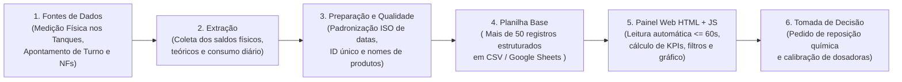

# Projeto de Sistema de Apoio à Decisão (BI)
## Gestão de Estoque e Consumo de Produtos Químicos em uma Estação de Tratamento de Água (ETA)

---

## 1. Escolha do Problema

### 1.1. Contexto e Situação Real
Em uma **Estação de Tratamento de Água (ETA)**, a continuidade operacional e a potabilidade da água distribuída à população dependem diretamente da disponibilidade ininterrupta de produtos químicos essenciais nas etapas de coagulação, floculação, decantação, filtração, desinfecção, fluoretação e correção de pH — tais como **Sulfato de Alumínio**, **PAC (Policloreto de Alumínio)**, **Hipoclorito de Sódio**, **Cal Hidratada**, **Ácido Fluossilícico** e **Polímero Auxiliar**.

No dia a dia operacional da ETA, o consumo desses produtos sofre variações bruscas devido à qualidade da água bruta captada (por exemplo, períodos de chuva intensa elevam drasticamente a turbidez e a cor da água, exigindo dosagens muito maiores de coagulantes e alcalinizantes) e também por divergências entre o consumo apontado pelos operadores de turno e o estoque físico real nos tanques de armazenamento e sacarias.

* **Distinção de Autenticidade (Fatos, Suposições e Simulações):**
  * **Fatos Reais:** A lista de produtos químicos utilizados no tratamento convencional de água, suas respectivas etapas de aplicação (coagulação, desinfecção, correção de pH, fluoretação), unidades de medida (kg/L) e a relação direta entre aumento de turbidez da água bruta em dias chuvosos e o pico de consumo de coagulantes.
  * **Suposições de Negócio:** Definição da meta de segurança operacional (autonomia mínima de 15 dias de estoque para cobrir o *lead time* de entrega de fornecedores químicos) e tolerância máxima de divergência física de 2%.
  * **Dados Simulados:** Os 50+ registros diários/semanais de movimentação de estoque, lotes, saldos físicos, consumos por turno e custos unitários foram simulados para preservar informações internas da operação, mantendo total coerência técnica com o porte de uma ETA real.

### 1.2. O Problema e suas Consequências
* **Problema:** Falta de visibilidade em tempo real sobre a **autonomia real do estoque (dias restantes de operação)** e ocorrência de **divergências entre o saldo teórico (calculado) e o saldo físico real** medido nos tanques dosadores e almoxarifado químico da ETA.
* **Consequências:**
  1. **Risco de Desabastecimento Operacional:** Se um produto crítico (como Hipoclorito de Sódio ou PAC) atingir nível zero antes da entrega do fornecedor, a ETA precisa reduzir a vazão tratada ou interromper a distribuição de água potável.
  2. **Custos Elevados com Compras Emergenciais:** Compras fora de contrato ou com frete químico urgente custam significativamente mais caro.
  3. **Desperdício e Descalibração Operacional:** Divergências negativas ocultam vazamentos em tanques, perdas por umidade em sacarias (como Cal Hidratada) ou bombas dosadoras descalibradas aplicando produto acima da dosagem ideal de *Jar Test*.

### 1.3. Pergunta Analítica
> *"Quais produtos químicos da ETA apresentam autonomia de estoque abaixo da margem de segurança operacional (15 dias) ou divergência crítica entre o estoque físico e o teórico no período filtrado, exigindo reposição imediata ou auditoria de dosagem?"*

### 1.4. Decisão Apoiada e Tomador de Decisão
* **Decisão Apoiada:** Acionar imediatamente o **pedido de compra/reposição prioritária** junto aos fornecedores para insumos abaixo da autonomia mínima de segurança e **determinar a aferição/calibração das bombas dosadoras ou revisão de armazenamento** nas etapas do tratamento que apresentarem divergência física acima do limite tolerado.
* **Quem toma a decisão:** **Coordenador Operacional da ETA / Engenheiro Químico Responsável** (em conjunto com o **Analista de Suprimentos/Almoxarifado**).

---

## 2. Planejamento do Sistema

### 2.1. Dados Necessários, Origem e Granularidade
* **De onde viriam os dados (Origem):**
  1. **Folha de Controle Operacional de Turno da ETA:** Apontamento diário feito pelos operadores da estação com o volume de produto químico consumido e a medição física de nível dos tanques/contagem de sacarias.
  2. **Controle de Almoxarifado / Notas Fiscais de Entrada:** Registros de recebimento de cargas químicas e custo unitário (R$/kg ou R$/L).
* **O que cada linha da planilha representará (Granularidade):**
  Cada linha da planilha representa um **registro de conferência e fechamento de estoque de um produto químico específico em uma determinada data/lote de controle na ETA**.
* **Colunas da Planilha Base:**
  * `ID_Registro`: Código único do apontamento (ex.: `REG-001` a `REG-055`).
  * `Data_Apontamento`: Data padronizada da conferência (`AAAA-MM-DD`).
  * `Produto_Quimico`: Nome padronizado do insumo (ex.: *Sulfato de Alumínio*, *PAC - Policloreto de Alumínio*, *Hipoclorito de Sódio 12%*, *Cal Hidratada*, *Ácido Fluossilícico*, *Polímero Aniônico*).
  * `Etapa_Tratamento`: Etapa onde o insumo atua (*Coagulação*, *Floculação*, *Correção de pH*, *Desinfecção*, *Fluoretação*).
  * `Unidade`: Unidade de controle (`kg` ou `L`).
  * `Estoque_Teorico`: Saldo esperado conforme entradas menos consumo teórico de dosagem.
  * `Estoque_Fisico_Atual`: Saldo real aferido fisicamente nos tanques/almoxarifado da ETA.
  * `Consumo_Medio_Diario`: Consumo médio diário atual do produto na estação (`kg/dia` ou `L/dia`).
  * `Custo_Unitario_BRL`: Custo por kg ou Litro em Reais (R$).
  * `Condicao_Agua_Bruta`: Condição operacional do período (*Normal* ou *Alta Turbidez - Chuva*).

### 2.2. Organização, Preparação e Regras de Qualidade de Dados
Os dados são registrados diretamente na planilha centralizada ao final das conferências de turno da ETA e lidos automaticamente pelo painel web via requisição HTTP assíncrona.

Foram estabelecidas **3 Regras de Qualidade de Dados** (superando o mínimo exigido de 2):
1. **Regra 1 — Prevenção de Duplicidades (Chave Única):** Cada lançamento possui um identificador único (`ID_Registro` no padrão `REG-XXX`) e uma chave composta lógica (`Data_Apontamento` + `Produto_Quimico`), impedindo que o mesmo produto tenha dois fechamentos conflitantes no mesmo dia/turno.
2. **Regra 2 — Padronização Estrita de Datas e Números:** Todas as datas seguem rigorosamente o padrão ISO `AAAA-MM-DD` (evitando ambiguidade entre `DD/MM/AAAA` e `MM/DD/AAAA` no JavaScript), e os valores numéricos não contêm símbolos de texto misturados (`R$` ou `kg` ficam restritos à formatação visual do painel).
3. **Regra 3 — Padronização Categórica e Validação de Domínio:** Os nomes dos produtos químicos e das etapas de tratamento utilizam nomenclatura fechada/padronizada (evitando variações como *"Hipoclorito"*, *"Hipo 12%"* e *"Cloro Líquido"*), garantindo que o filtro e os agrupamentos do gráfico somem os valores sem perda de registros. Não são permitidos valores negativos ou consumo diário igual a zero (para evitar erro de divisão por zero).

### 2.3. Definição dos Indicadores e Escolha do KPI

O sistema calcula dinamicamente **dois indicadores principais** a partir das linhas filtradas da planilha:

| Atributo | Indicador 1 (KPI Principal) | Indicador 2 (Indicador Operacional de Controle) |
| :--- | :--- | :--- |
| **Nome do Indicador** | **Autonomia Média de Estoque (Cobertura em Dias)** | **Taxa de Divergência Física de Estoque (%)** |
| **Fórmula de Cálculo** | $$\text{Autonomia (dias)} = \frac{\sum \text{Estoque Físico Atual}}{\sum \text{Consumo Médio Diário}}$$ *(calculado também individualmente por produto)* | $$\text{Divergência (\%)} = \left( \frac{\sum |\text{Estoque Teórico} - \text{Estoque Físico}|}{\sum \text{Estoque Teórico}} \right) \times 100$$ |
| **Unidade de Medida** | Dias (`dias`) | Percentual (`%`) — acompanhado do impacto em `R$` |
| **Frequência de Atualização** | Tempo real / A cada conferência de turno (painel sincroniza automaticamente a cada $\le 60\text{s}$) | Tempo real / A cada conferência de turno (painel sincroniza automaticamente a cada $\le 60\text{s}$) |
| **Meta ou Parâmetro** | **Meta:** $\ge 15,0\text{ dias}$ de autonomia *(Alerta Amarelo: $10\text{ a }14,9\text{ dias}$ \| Crítico Vermelho: $< 10\text{ dias}$)* | **Meta:** $\le 2,0\%$ de divergência máxima tolerada *(Alerta Amarelo: $2,1\%\text{ a }5,0\%$ \| Crítico Vermelho: $> 5,0\%$)* |

#### Justificativa do KPI Principal:
O indicador **Autonomia de Estoque (Cobertura em Dias)** foi escolhido como o **KPI (Key Performance Indicator)** principal porque está diretamente atrelado ao objetivo estratégico vital da ETA: **garantir 100% de continuidade no fornecimento de água potável**. Enquanto a *Taxa de Divergência (%)* mede a eficiência interna do controle de almoxarifado e calibração de dosagem, a *Autonomia em Dias* traduz o estoque físico em tempo de sobrevivência operacional frente ao consumo real, considerando o prazo de entrega (*lead time*) da indústria química.

### 2.4. Tipo de Análise Realizada
* **Análise Primária — Descritiva:** Consolida o histórico e o estado atual dos estoques químicos da ETA, apresentando saldos físicos, autonomia em dias por produto, consumo médio e o percentual de divergência em relação à meta por meio de cartões sinalizadores, gráfico comparativo e tabela detalhada.
* **Análise Complementar — Diagnóstica:** Ao permitir cruzar e filtrar os dados por **Produto Químico**, **Etapa do Tratamento** e **Condição da Água Bruta (Normal vs. Alta Turbidez - Chuva)**, o painel ajuda a diagnosticar *por que* a autonomia caiu abruptamente (ex.: identificar que em dias de alta turbidez o consumo de *Sulfato de Alumínio* e *PAC* dobra, reduzindo a autonomia pela metade e aumentando a divergência por ajustes manuais nas bombas dosadoras).

### 2.5. Apoio à Decisão e Acompanhamento de Melhoria
* **Resultado Possível Identificado no Painel:** Ao filtrar a etapa de *Coagulação* ou o produto *PAC - Policloreto de Alumínio*, o gestor observa que a **Autonomia caiu para 7,5 dias** (sinalização **Vermelha Crítica**, abaixo da meta de 15 dias) e a **Divergência Física atingiu 6,8%** (acima da meta de 2,0%).
* **Ação Concreta Apoiada:**
  1. Emitir pedido de compra emergencial/antecipação de entrega do lote de *PAC* junto ao fornecedor homologado antes que o tanque atinja o nível mínimo de sucção.
  2. Enviar a equipe de manutenção/operação para aferir a vazão da bomba dosadora de coagulante e verificar possíveis vazamentos na linha de recalque ou falhas de apontamento no turno noturno.
* **Como acompanhar se houve melhoria:** Nos ciclos seguintes de apontamento na planilha (dias subsequentes), verificar no painel se a entrada da nova nota fiscal restabeleceu a **Autonomia para $\ge 15\text{ dias}$ (Sinalização Verde)** e se, após a calibração da bomba dosadora, a **Taxa de Divergência retornou ao patamar $\le 2,0\%$**.

### 2.6. Limitação Analítica (Cuidado na Interpretação)
* **Cuidado Necessário:** A fórmula da *Autonomia em Dias* divide o estoque físico atual pelo *Consumo Médio Diário* recente. Se o cálculo for feito durante uma semana de **estiagem (água bruta limpa, baixa turbidez)**, a autonomia parecerá alta e confortável (ex.: 25 dias). Porém, a chegada repentina de uma frente fria com **chuvas intensas** pode triplicar a turbidez do rio e dobrar a dosagem de coagulante em poucas horas, fazendo com que aqueles 25 dias teóricos durem apenas 10 a 12 dias na prática. Portanto, o decisor nunca deve interpretar a autonomia isoladamente sem observar a variável de condição climática/turbidez e a época do ano.

### 2.7. Fluxo de Dados do Sistema

1. **Fontes:** Medições físicas de nível dos tanques e sacarias na ETA, boletins diários de operação de turno e notas fiscais de recebimento de produtos químicos.
2. **Extração:** Coleta dos volumes consumidos, saldos teóricos do sistema e contagem física realizada pelos operadores da ETA.
3. **Preparação:** Aplicação das regras de qualidade (atribuição de `ID_Registro` sem duplicidade, datas em `AAAA-MM-DD`, padronização dos nomes dos 6 produtos químicos e validação de valores numéricos positivos).
4. **Planilha:** Armazenamento estruturado na planilha base de dados (com mais de 50 registros históricos e atuais), servindo como fonte única da verdade (*Single Source of Truth*).
5. **Painel:** Aplicação web em HTML5, CSS3 e JavaScript que consome a planilha automaticamente a cada 30 segundos (dentro do limite de 60s), processa os filtros, calcula os dois indicadores em tempo de execução, renderiza os gráficos e aplica a sinalização visual de metas (Verde/Amarelo/Vermelho).
6. **Decisão:** O Coordenador da ETA visualiza os alertas críticos, prioriza a compra dos produtos com baixa cobertura e corrige desvios operacionais de dosagem.

### 2.8. Enquadramento: BI, Big Data e Ciência de Dados + Fonte Externa
* **Uso de Business Intelligence (BI):** A proposta utiliza **BI clássico e operacional** em sua essência: coleta dados estruturados de processos internos da ETA, transforma esses dados brutos em indicadores padronizados (Autonomia e Divergência), disponibiliza visualizações interativas com filtros e semáforos de meta, e apoia decisões gerenciais imediatas baseadas em fatos.
* **Há necessidade de Big Data?** **Não.** O volume, a velocidade e a variedade dos dados de estoque químico de uma ETA (dezenas ou poucas centenas de registros por mês, totalmente tabulares e estruturados) são perfeitamente atendidos por planilhas e bancos relacionais leves. *Big Data* só seria aplicável caso a ETA integrasse milhares de sensores IoT transmitindo telemetria de vazão, pH, turbidez e nível de tanques a cada milissegundo ao longo de anos para múltiplas estações simultaneamente.
* **Há necessidade de Ciência de Dados?** **No escopo atual do protótipo, não é obrigatório**, pois a análise descritiva e diagnóstica via BI já resolve o problema de visibilidade e alerta de reposição. Contudo, como **evolução futura**, a *Ciência de Dados (Machine Learning)* seria altamente útil para criar um modelo **preditivo** capaz de prever o consumo de Sulfato de Alumínio e PAC para os próximos 15 dias cruzando dados históricos de dosagem com a previsão meteorológica de precipitação (chuva) na bacia hidrográfica.
* **Fonte Externa e Avaliação de Confiabilidade:**
  * Caso a decisão de compra envolva antecipar aquisições devido ao risco de alta no preço de insumos químicos ou previsão de chuvas severas na bacia de captação, duas fontes externas relevantes são:
    1. **INMET (Instituto Nacional de Meteorologia) / ANA (Agência Nacional de Águas e Saneamento Básico):** Para monitoramento de chuvas e vazão dos rios que impactam a turbidez da água bruta.
    2. **ABIQUIM (Associação Brasileira da Indústria Química) / Índices Setoriais (FIPE/IBGE):** Para acompanhar variações de preço e disponibilidade de cloro, álcalis e coagulantes no mercado nacional.
  * **Como avaliar a confiabilidade:** Verificar se a fonte é um órgão oficial governamental ou entidade setorial reconhecida, checar a periodicidade de atualização dos boletins, a metodologia de coleta divulgada e a consistência histórica dos dados publicados.

---

## 3. Especificação Técnica para o Desenvolvimento (Próxima Etapa)

Para atender 100% dos requisitos do item 3 da atividade, o sistema será construído com:
1. **Planilha Base (`estoque_quimicos_eta.csv` / compatível com Excel e Google Sheets):** Contendo **55 registros** distribuídos entre 6 produtos químicos reais de ETA, com colunas limpas e regras de qualidade aplicadas.
2. **Painel Interativo (`index.html`):**
   * Conectado dinamicamente à planilha via `fetch()` assíncrono com *cache-busting* (`?t=timestamp`).
   * **Atualização automática a cada 30 segundos** (atendendo ao requisito de $\le 60\text{ segundos}$), com contador regressivo e exibição da **Data e Horário da última leitura bem-sucedida**.
   * **Cálculo 100% dinâmico via JavaScript:** Nenhum indicador fixo no código.
   * **Filtros Interativos:** Filtro por **Produto Químico**, **Etapa do Tratamento** e **Condição da Água Bruta (Normal / Alta Turbidez)**, além de busca rápida.
   * **Sinalização Visual de Metas (Semáforo):**
     * *Autonomia de Estoque:* Verde ($\ge 15\text{ dias}$), Amarelo ($10\text{ a }14,9\text{ dias}$), Vermelho ($< 10\text{ dias}$).
     * *Divergência Física:* Verde ($\le 2,0\%$), Amarelo ($2,1\%\text{ a }5,0\%$), Vermelho ($> 5,0\%$).
   * **Visualizações:** Gráficos dinâmicos (Autonomia em Dias por Produto vs. Linha de Meta de 15 dias + Divergência/Consumo por Etapa) e Tabela completa de registros com destaque visual nas linhas críticas.

---

## 4. Registro de Testes, Validação e Uso de IA (Preparado para a Entrega)

### 4.1. Ferramenta de IA Utilizada e Pedido Inicial (Prompt)
* **Ferramenta Utilizada:** Google Antigravity (Assistente de IA).
* **Pedido Inicial Realizado:**
  > *"Crie um documento com as premissas básicas da atividade e desenvolva o planejamento e o sistema em cima de gestão de estoque de produtos químicos de uma estação de tratamento de água (ETA), contendo planilha com pelo menos 50 registros, painel HTML/JS conectado à planilha com atualização automática em até 60 segundos, dois indicadores (sendo um KPI com meta), filtro, gráfico e tabela."*

### 4.2. Registro de Erro/Inadequação Identificado e Como foi Corrigido
* **Problema / Inadequação Identificada durante o Desenvolvimento:**
  1. **Cache do Navegador na Atualização Automática:** Ao configurar o `fetch()` em JavaScript para ler a planilha a cada 30 segundos, o navegador reutilizava a versão em cache do arquivo da planilha, fazendo com que alterações salvas na planilha não aparecessem imediatamente no painel.
  2. **Cálculo Ponderado vs. Média Simples na Autonomia:** Inicialmente, calcular a autonomia geral tirando a média aritmética simples das autonomias de cada linha distorcia o indicador quando produtos de alto volume (como Sulfato de Alumínio em kg) eram misturados com produtos de menor dosagem (como Polímero).
* **Como foi Corrigido:**
  1. Foi adicionado um parâmetro dinâmico de *cache-busting* na URL de leitura da planilha (`fetch(url + '?nocache=' + new Date().getTime())` e cabeçalho `Cache-Control: no-cache`), forçando o navegador a buscar os dados novos da planilha a cada ciclo de atualização automática.
  2. A fórmula no JavaScript foi ajustada para calcular tanto a **Autonomia Ponderada Global** ($\sum \text{Estoque Físico dos últimos fechamentos} / \sum \text{Consumo Diário}$) quanto a **Autonomia Individual por Produto** e a identificação imediata do **Produto Mais Crítico (menor cobertura em dias)**, garantindo precisão matemática na conferência independente.
